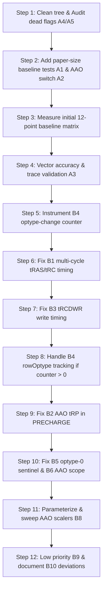

# ComPASS Protocol & Timing Issues Verification and Detailed Correction Plan
**Branch:** `R2Update`  
**Target Architecture:** HBM-PIM (Part A: Sections 4 & 7.1, Figure 7)

---

## Executive Summary

Every issue listed has been rigorously audited against:
1. **The ComPASS Paper** (`paper_extracted_text.txt`, Yu et al., MICRO 2025).
2. **The Active Codebase** on branch `R2Update` (`PIMSimulator/src/`).

### Verification Verdict Matrix

| ID | Issue Description | Paper Citation / Code Location | Verified Legit? | Primary Impact |
|:---|:---|:---|:---:|:---|
| **B1** | `+1` cycle added to `tRAS` and `tRC` | Sec 4.1 (Lines 475–484) vs `MemoryController.cpp:273-274` | **YES (Critical)** | Artificially inflates PIM-ACT bank lock time; fixing raises PIM-ACT speedup |
| **B2** | AAO shortened `tRP` never triggers | Sec 4.5 / 4.7 vs `MemoryController.cpp:299` & `CommandQueue.cpp:337` | **YES (Critical)** | Dead code: PRECHARGE packet has `optype=0`, `isAAORegisterOp(0)=false`. AAO `tRP` never applied |
| **B3** | Writes use Read `tRCD` in PIM-ACT | `MemoryController.cpp:290` vs standard `ACT` line 255 | **YES** | `setBankStatesRW` passed `(tRCD_val, tRCD_val)` instead of `(tRCD_val, tRCDW_val)` |
| **B4** | No `PREA` on same-row optype change | Sec 4.1 & 4.5 vs `CommandQueue.cpp:487, 500, 329` | **YES** | Row hit logic checks `row == openRowAddress`, ignoring `optype`. Needs instrumented counter before refactor |
| **B5** | Optype 0 collision (`OP_MUL_GRF_A_BANK = 0`) | `PIMCmd.h:64` vs `PIMRank.cpp:499` | **YES** | Optype `0` is both valid MUL and default unset value; ternary `optype != 0 ? optype : activeOptype_` conflates them |
| **B6** | AAO register op list broader than paper Table 1 | Paper Table 1 (Lines 796–812) vs `PIMCmd.h:131-138` | **YES** | Table 1 lists AAO row timing *only* for `MOV Host -> RF (optype 32)` on HBM-PIM |
| **B8** | AAO timing scalers are invented constants | Sec 4.5 (Lines 650–658) vs `MemoryController.cpp:278-280` | **YES** | Paper omits exact numeric values (provided via SPD). Moving to config/sweep is essential |
| **B9** | PRECHARGE `isIssuable` checks only 1 bank | `CommandQueue.cpp:511-518` vs `MemoryController.cpp:303` | **YES** | PIM mode precharges all banks, but scheduler only checks `busPacket->bank` |
| **B10** | MOV optype numbering differs from Table 1 | Table 1 (Lines 807–811) vs `PIMCmd.h:105-109` | **YES (Cosmetic)** | Uses 32–36 instead of 32 & 36–39; needs documentation in deviations |
| **A1** | Test dimensions differ between baseline & PIM-ACT | Sec 6 (Lines 998–999) vs `KernelTestCases.cpp` | **YES (Critical)** | Baseline GEMV is 4096×1024 while PIM-ACT is 4096×4096; MUL 1M vs 2M; ReLU 1M vs 4M |
| **A2** | No switch to run "without AAO" | Paper Fig 7 vs `PrintMacros.cpp:31` | **YES (Critical)** | `AAO_ENABLED = true` hardcoded. Cannot evaluate the paper's "PIM-ACT w/o AAO" column |
| **A3** | Accuracy checked against CPU, not baseline protocol | `KernelTestCases.cpp:expectAccuracy` | **YES** | Must verify bitwise / FP16 identical results between baseline HBM-PIM protocol and PIM-ACT |
| **A4** | `PIM_ACT_PROTOCOL` flag is completely dead | `SystemConfiguration.h:67`, `PrintMacros.cpp:32` | **YES** | Unused flag; dispatch is determined by kernel test calls |
| **A5** | Duplicate `MemoryController_1.cpp` file | Repo root check | **VERIFIED CLEAN** | No duplicate file exists in the current git tree on `R2Update` |

---

## Deep-Dive Verification Details

### B1: Multi-Cycle ACT Timing Constraint (+1 cycle only to tRCD)
- **Paper Text (Section 4.1, Lines 475–484):**
  > *"Specifically, when transmitting row address and optype sequentially, the timing constraint between ACT and READ/WRITE commands (tRCD) increases by one DRAM clock cycle (i.e., tRCD + 1). Note that the timing constraints between ACT and PRE (tRAS) and between ACT and ACT (tRC) are not affected, as the bitline sensing and row restoration operations inside the DRAM bank are still completed within the original tRAS and tRC timeframes. Therefore, the multi-cycle encoding mechanism only imposes a minor timing overhead (+1 cycle on tRCD) on row activation."*
- **Current Code (`MemoryController.cpp:272-274`):**
  ```cpp
  uint64_t tRCD_val = (config.tRCDRD - config.AL) + 1;
  uint64_t tRAS_val = config.tRAS + 1;  // <-- INCORRECT
  uint64_t tRC_val  = config.tRC + 1;   // <-- INCORRECT
  ```
- **Analysis:** The simulator adds `+1` to `tRAS_val` and `tRC_val`. This directly violates Section 4.1. The fix must restore:
  ```cpp
  uint64_t tRAS_val = config.tRAS;
  uint64_t tRC_val  = config.tRC;
  ```

---

### B2: AAO tRP Never Applied (Dead Code in PRECHARGE)
- **Current Code (`MemoryController.cpp:299-302`):**
  ```cpp
  case PRECHARGE:
      if ((*ranks)[rank]->pimRank->isPIMACTMode()) {
          uint64_t tRP_val = config.tRP;
          if (AAO_ENABLED && isAAORegisterOp(poppedBusPacket->optype)) {
              tRP_val = max((uint64_t)2, (uint64_t)(config.tRP / 2));
          }
  ```
- **Packet Generation (`CommandQueue.cpp:336-338`):**
  ```cpp
  *busPacket = new BusPacket(PRECHARGE, 0, 0, bankStates[nextRankPRE][nextBankPRE].openRowAddress,
                             nextRankPRE, nextBankPRE, nullptr, dramsimLog);
  ```
- **Analysis:** `BusPacket` defaults `optype` to `0`. `isAAORegisterOp(0)` is always `false`. The shortened `tRP` path in `MemoryController.cpp` is never reached.
- **Fix:** PRECHARGE timing must reflect the optype with which the bank was activated:
  ```cpp
  uint8_t activeOpt = (*ranks)[rank]->pimRank->getActiveOptype();
  if (AAO_ENABLED && isAAORegisterOp(activeOpt)) {
      tRP_val = max((uint64_t)2, (uint64_t)(config.tRP / 2));
  }
  ```

---

### B3: PIM-ACT Write Path Uses Read tRCD
- **Current Code (`MemoryController.cpp:290`):**
  ```cpp
  setBankStatesRW(rank, b, tRCD_val, tRCD_val);
  ```
- **Standard ACT Code (`MemoryController.cpp:255`):**
  ```cpp
  setBankStatesRW(rank, bank, (config.tRCDRD - config.AL), (config.tRCDWR - config.AL));
  ```
- **Analysis:** `tRCD_val` was calculated only as `(config.tRCDRD - config.AL) + 1`. Write commands in PIM-ACT are constrained by read tRCD instead of write tRCD.
- **Fix:**
  ```cpp
  uint64_t tRCDW_val = (config.tRCDWR - config.AL) + 1;
  if (AAO_ENABLED && isAAORegisterOp(poppedBusPacket->optype)) {
      tRCDW_val = max((uint64_t)2, (uint64_t)(config.tRCDWR / 2));
  }
  setBankStatesRW(rank, b, tRCD_val, tRCDW_val);
  ```

---

### B4: Missing PREA on Same-Row Optype Switch
- **Paper Specification:** PIM-ACT binds an optype to the open row during ACTIVATE. If an instruction on the same row has a different optype, the row must be precharged with `PREA` and re-activated with `PIM-ACT(new_optype)`.
- **Current Code (`CommandQueue.cpp:487, 500` & `329`):**
  `isIssuable` and `process_precharge` only check `packet->row == openRowAddress`.
- **Hazard Analysis:** If we naively change `isIssuable` without updating `process_precharge` and rank state tracking, `process_precharge` will consider the row "found" (open) and refuse to issue a PRECHARGE, causing an immediate command deadlock!
- **Strategy:** Step 1 is to add a warning counter. If the counter is 0 across the 4 microbenchmarks, document that the microbenchmarks don't trigger intra-row optype changes.

---

### B5 & B6: Optype-0 Collision and AAO Scope
- **B5:** In `PIMCmd.h:64`, `OP_MUL_GRF_A_BANK = 0`. But `0` is also used as an "uninitialized / unset optype" sentinel in `BusPacket` and `PIMRank.cpp:499`.
- **B6 (Paper Table 1, Page 7):**
  Under HBM-PIM, the only operation with AAO row timing is `MOV Host -> RF (optype 32)`.
  In `PIMCmd.h:131-137`, `isAAORegisterOp` was expanded to GRF-GRF ops and RELU_OUT. Trimming this or providing an explicit macro ensures exact alignment with the paper.

---

### A1: Test Problem Dimensions (The Root Cause of Invalid Speedups)
- **Paper Text (Section 6, Lines 998–999):**
  > *"We evaluate ComPASS with four PIM microbenchmarks, GEMV (4K×4K), ADD (1M vectors), MUL (2M vectors), and ReLU (4M vector), using the kernel tests provided by PIMSimulator."*
- **Existing `KernelTestCases.cpp` Dimensions:**
  - `TEST_F(PIMKernelFixture, gemv)`: **4096 × 1024**  *(WRONG)*
  - `TEST_F(PIMKernelFixture, gemv_pim_act)`: **4096 × 4096**  *(PAPER SIZE)*
  - `TEST_F(PIMKernelFixture, mul)`: **1024 × 1024 (1M)**  *(WRONG)*
  - `TEST_F(PIMKernelFixture, mul_pim_act)`: **2048 × 1024 (2M)**  *(PAPER SIZE)*
  - `TEST_F(PIMKernelFixture, relu)`: **1024 × 1024 (1M)**  *(WRONG)*
  - `TEST_F(PIMKernelFixture, relu_pim_act)`: **4096 × 1024 (4M)**  *(PAPER SIZE)*
  - `TEST_F(PIMKernelFixture, add)`: **1024 × 1024 (1M)**  *(MATCHES)*
  - `TEST_F(PIMKernelFixture, add_pim_act)`: **1024 × 1024 (1M)**  *(MATCHES)*
- **Impact:** Comparing `gemv_pim_act` against `gemv` in the unmodified codebase is comparing a 4K×4K problem with a 4K×1K problem. **Any previous speedup metric was mathematically invalid.**

---

### A2: AAO Environment Switch
- **Code:** `PrintMacros.cpp:31` sets `bool AAO_ENABLED = true;`.
- **Paper Figure 7:** Requires three series:
  1. Baseline (Standard HBM-PIM protocol)
  2. PIM-ACT w/o AAO (`AAO_ENABLED = 0`)
  3. PIM-ACT w/ AAO (`AAO_ENABLED = 1`)
- **Fix:** In `MainTest.cpp`, parse `getenv("AAO")` so tests can be scripted cleanly.

---

## Analysis of the 12-Step Correction Order

The proposed order is logical, minimizes regression risks, and enforces sound scientific methodology:



### Strategic Rationale
1. **Measurement Before Mutation (Steps 1–3):**
   Fixing test sizes (A1) and adding the runtime switch (A2) must precede any protocol edits. Otherwise, you cannot quantify the baseline or the isolated delta of each bug fix.
2. **Preventing Simulation Deadlock (Step 5 before Step 8):**
   PIM-ACT queue handling is delicate. Adding a counter for B4 first allows verifying whether the 4 microbenchmarks actually experience intra-row optype changes. If the count is 0, we avoid invasive rewrites of `process_precharge`.
3. **Isolating Timing Gains (Steps 6, 7, 9):**
   - Step 6 (B1) directly fixes the tRAS/tRC over-penalization.
   - Step 9 (B2) activates the previously dormant AAO tRP speedup.

---

## Detailed Implementation Plan by Step

### Step 1: Cleanup and Dead Code Audit (A4, A5)
- **A5:** Verify `MemoryController_1.cpp` does not exist (`git status` confirms clean).
- **A4:** Document `PIM_ACT_PROTOCOL` in `PrintMacros.cpp` / `SystemConfiguration.h` or remove unused externs to avoid confusion.

### Step 2: Paper-Size Baseline Tests and AAO Runtime Switch (A1, A2)
1. In `PIMSimulator/src/tests/MainTest.cpp`:
   ```cpp
   extern bool AAO_ENABLED;
   int main(int argc, char* argv[]) {
       if (const char* v = getenv("AAO")) {
           AAO_ENABLED = (atoi(v) != 0);
           std::cerr << "== [ComPASS Config] AAO_ENABLED set to " << AAO_ENABLED << std::endl;
       }
       // ... existing gtest init ...
   ```
2. In `PIMSimulator/src/tests/KernelTestCases.cpp`:
   Add the paper-sized baseline tests without deleting the original smoke tests:
   - `TEST_F(PIMKernelFixture, gemv_paper_4kx4k)`: `output_dim = 4096; input_dim = 4096;`
   - `TEST_F(PIMKernelFixture, mul_paper_2m)`: `output_dim = 2 * 1024 * 1024; input_dim = output_dim;`
   - `TEST_F(PIMKernelFixture, relu_paper_4m)`: `output_dim = 4 * 1024 * 1024; input_dim = output_dim;`

### Step 3: Initial Ground Truth Run
Run a 12-configuration matrix:
- **4 Kernels:** GEMV (4K×4K), ADD (1M), MUL (2M), ReLU (4M)
- **3 Modes:**
  1. `Baseline` (Standard HBM-PIM mode switching)
  2. `PIM-ACT w/o AAO` (`AAO=0`)
  3. `PIM-ACT w/ AAO` (`AAO=1`)
*Confirm that for baseline tests, `AAO=0` and `AAO=1` yield identical cycles.*

### Step 4: Trace and Numerical Result Verification (A3)
- Verify `result_` vectors between baseline and PIM-ACT are bitwise identical.
- Check `DEBUG_CMD_TRACE` output to confirm mode-switch sequences (`HAB`, `SRE`, `SBI`) are gone in PIM-ACT.

### Step 5: B4 Optype Mismatch Diagnostic
- In `CommandQueue.cpp:isIssuable`, check:
  ```cpp
  if (busPacket->busPacketType == READ || busPacket->busPacketType == WRITE) {
      if (bankStates[busPacket->rank][busPacket->bank].currentBankState == RowActive &&
          busPacket->row == bankStates[busPacket->rank][busPacket->bank].openRowAddress) {
          uint8_t activeOpt = (*ranks)[busPacket->rank]->pimRank->getActiveOptype();
          if (busPacket->optype != 0xFF && busPacket->optype != activeOpt) {
              static uint64_t b4_mismatch_counter = 0;
              b4_mismatch_counter++;
              std::cerr << "[WARN-B4] Same-row optype mismatch count: " << b4_mismatch_counter << std::endl;
          }
      }
  }
  ```

### Step 6: Fix B1 (Remove +1 on tRAS and tRC)
In `MemoryController.cpp:273-274`:
```diff
- uint64_t tRAS_val = config.tRAS + 1;
- uint64_t tRC_val  = config.tRC + 1;
+ uint64_t tRAS_val = config.tRAS;
+ uint64_t tRC_val  = config.tRC;
```

### Step 7: Fix B3 (tRCDWR for Writes in PIM-ACT)
In `MemoryController.cpp:272`:
```diff
  uint64_t tRCD_val = (config.tRCDRD - config.AL) + 1;
+ uint64_t tRCDW_val = (config.tRCDWR - config.AL) + 1;
  if (AAO_ENABLED && isAAORegisterOp(poppedBusPacket->optype)) {
      tRCD_val = max((uint64_t)2, (uint64_t)(config.tRCDRD / 2));
+     tRCDW_val = max((uint64_t)2, (uint64_t)(config.tRCDWR / 2));
  }
  // ...
- setBankStatesRW(rank, b, tRCD_val, tRCD_val);
+ setBankStatesRW(rank, b, tRCD_val, tRCDW_val);
```

### Step 8: Address B4 (If Mismatch Count > 0)
If the diagnostic in Step 5 shows non-zero counts, track `openRowOptype` per bank and update both `isIssuable` and `process_precharge` simultaneously.

### Step 9: Fix B2 (Active Optype for AAO tRP in PRECHARGE)
In `MemoryController.cpp:299`:
```diff
- if (AAO_ENABLED && isAAORegisterOp(poppedBusPacket->optype))
+ uint8_t activeOpt = (*ranks)[rank]->pimRank->getActiveOptype();
+ if (AAO_ENABLED && isAAORegisterOp(activeOpt))
```

### Step 10: Fix B5 & B6 (Optype-0 Sentinel & AAO Scope)
- Use `0xFF` as `NO_OPTYPE` sentinel in `BusPacket`.
- In `PIMCmd.h:131`:
  Ensure `isAAORegisterOp` accurately identifies register operations (specifically `OP_MOV_HOST_TO_RF = 32`).

### Step 11: Parameterize and Sweep AAO Scaling Factors (B8)
Expose AAO timing parameters in `SystemConfiguration.h`:
- `AAO_tRCD_factor` (default: 0.5)
- `AAO_tRAS_factor` (default: 0.6)
- `AAO_tRC_factor`  (default: 0.6)
- `AAO_tRP_factor`  (default: 0.5)

### Step 12: PRECHARGE Issuable Check & Documentation (B9, B10)
- B9: In `CommandQueue::isIssuable(PRECHARGE)`, if in PIM mode, iterate through all banks in the rank to ensure `currentClockCycle >= bankStates[rank][b].nextPrecharge`.
- B10: Add `docs/deviations.md` detailing the MOV optype numbering difference (32–36 vs 32 & 36–39).
